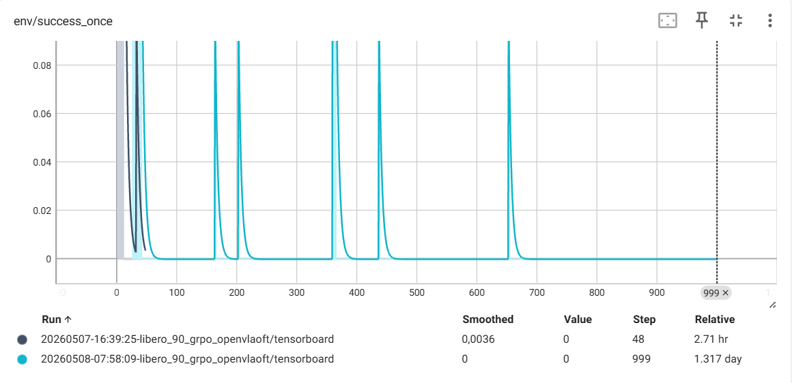
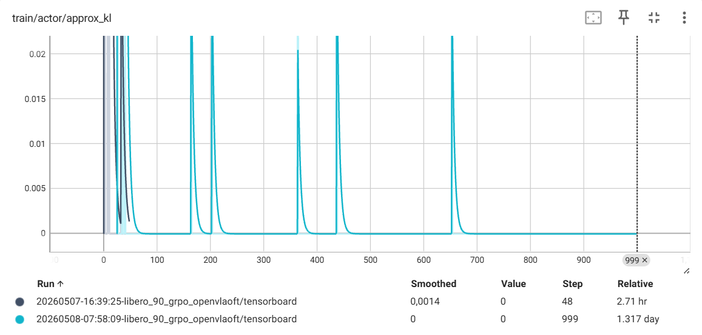
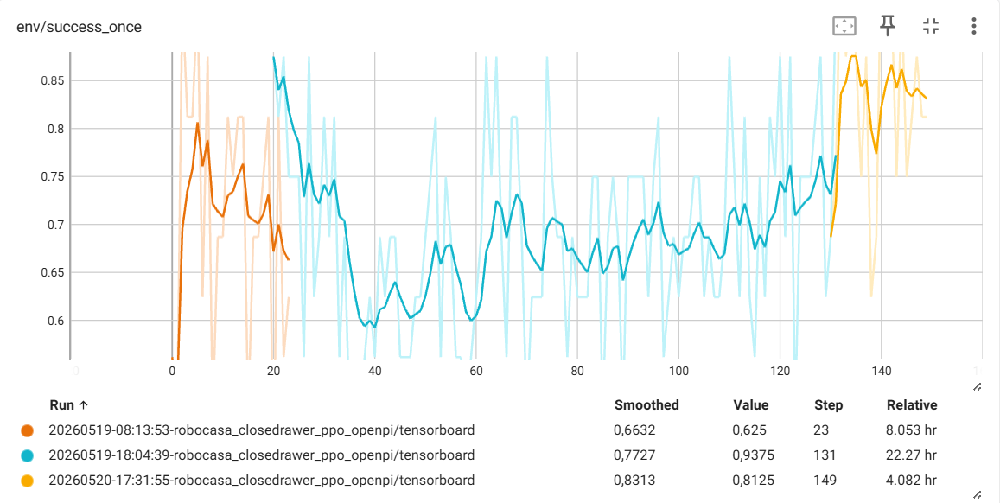
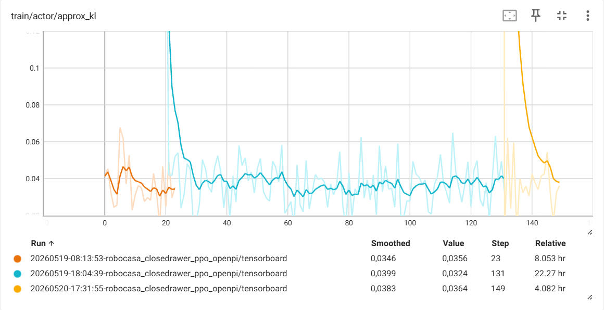
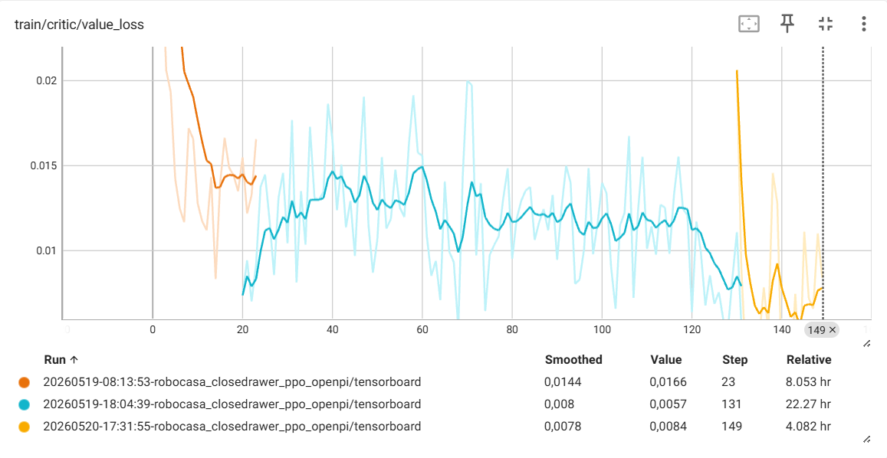
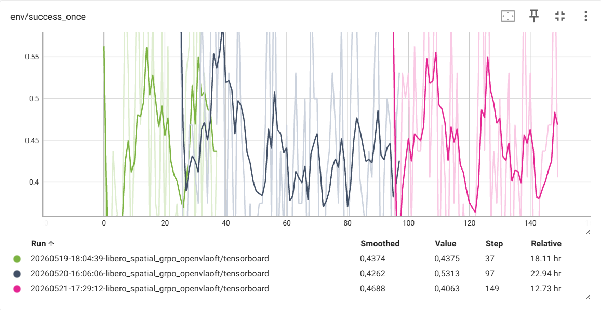
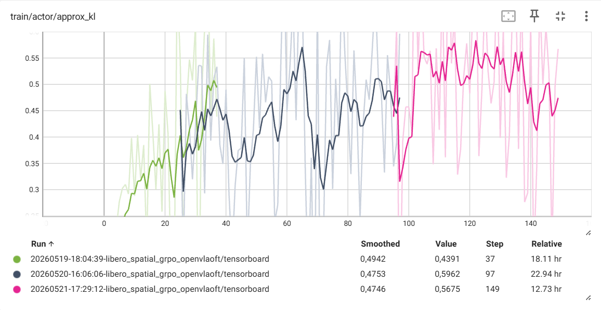
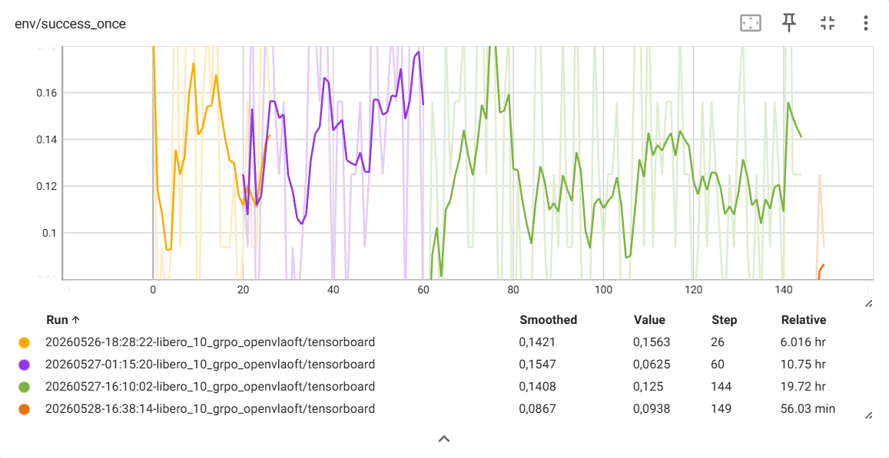
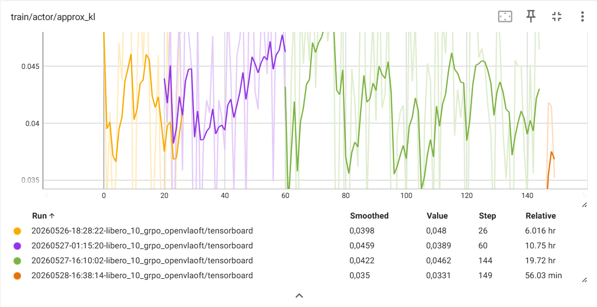

# Project Tracking

## Week 1 (May 4–9, 2026)

### Goals for the period
- Get in touch with the team and set up the work environment
- Launch a first RL training run on the Mila cluster
- Identify and resolve infrastructure issues

### Work completed

!!! abstract "Progress"
    - [x] Connected with the team, joined the lab's Slack
    - [x] Read the RLinf documentation (LIBERO)
    - [x] Connected to the Mila cluster and resolved access issues with IT support
    - [x] Cloned the repository and installed dependencies on an interactive compute node (`salloc --no-root`)
    - [x] Wrote the `job.sh` script and submitted it via `sbatch`
    - [x] Progressively resolved errors: wrong normalization key, insufficient CPU RAM, insufficient GPU VRAM, multi-GPU NCCL timeout
    - [x] Switched to A100L GPU (80GB) with `enable_offload: True` and `PYTORCH_CUDA_ALLOC_CONF=expandable_segments:True`
    - [x] First successful training run reaching 132 steps
    - [x] Migrated project to `$SCRATCH`, created symbolic link from `$HOME`, added automatic checkpoint cleanup script
    - [x] Full 1000-step training completed (31h40)
    - [x] Versioned job script and config on GitHub
    - [ ] Batch size increase — deferred to next week

### Decisions and adjustments

!!! info "Decisions"
    - Dropped L40S GPU (44GB insufficient) in favor of A100L (80GB)
    - Switched to single-GPU setup with `enable_offload: True` instead of multi-GPU (NCCL issues)
    - Reduced scope: moved away from LIBERO-90 (90 simultaneous tasks) toward a more focused configuration
    - Added checkpoint cleanup script to avoid filling up storage

### Difficulties encountered

!!! warning "Difficulties"
    - The model is loaded twice into GPU memory (RolloutGroup + ActorGroup), doubling the memory footprint and causing OOM errors
    - Resolved by enabling `enable_offload: True` and setting `PYTORCH_CUDA_ALLOC_CONF=expandable_segments:True`
    - Corrupted checkpoint at step 50: the `$HOME` directory (96GB) was too small to store checkpoints (~50GB each)
    - Resolved by moving the project to `$SCRATCH` and adding the cleanup script
    - Ray conflict on the assigned node: a residual Ray cluster from another user prevented initialization
    - Resolved by excluding the contaminated node via `#SBATCH --exclude`
    - Training results at 1000 steps: occasional reward spikes (~0.13) with no stable learning trend — batch size too small to extract a robust learning signal
        
        

## Week 2 (May 11–15, 2026)

### Goals for the period
- Analyze the previous training results and plan next steps
- Switch environment and model based on supervisor recommendations
- Launch a first training run with the new setup

### Work completed

!!! abstract "Progress"
    - [x] Discussion with the team on Week 1 results and next steps
    - [x] Switched to RoboCasa environment with the π0 model (~3B parameters) using PPO
    - [x] Installed RoboCasa dependencies and downloaded kitchen assets (~5GB)
    - [ ] First successful training run with π0 — blocked by a Ray initialization hang

### Decisions and adjustments

!!! info "Decisions"
    - Dropped OpenVLA-OFT as the primary model in favor of π0 (~3B), better suited for research
    - Dropped LIBERO as the primary benchmark (mostly saturated) in favor of RoboCasa
    - LoRA will be enabled to reduce memory footprint in the next training run

### Difficulties encountered

!!! warning "Difficulties"
    - The reward spikes from the previous week are explained by an exploration issue, not batch size — gradient accumulation has no effect on learning dynamics
    - Ray hang at job startup: the Ray process initializes then blocks with no further output. Root cause under investigation.

## Week 3 (May 18–22, 2026)

### Goals for the period
- Launch a successful π0 training run on RoboCasa
- Start a LIBERO-Spatial training run with OpenVLA-OFT
- Document and share experiments with the team

### Work completed

!!! abstract "Progress"
    - [x] Enabled LoRA (rank 32) for π0 and tuned config for single A100L (80GB)
    - [x] First successful π0 + RoboCasa CloseDrawer (PPO) run — 24 steps, `success_once` reaching 0.8125 at step 20
    - [x] Resolved `robosuite` version conflict between LIBERO and RoboCasa — created two separate venvs (`.venv-robocasa` and `.venv-libero`)
    - [x] Updated all job scripts to point to the correct venv
    - [x] Opened PR on `montrealrobotics/RLinf` with configs, job scripts, and `EXPERIMENTS_README.md`
    - [x] Started LIBERO-Spatial GRPO run — `success_once` oscillating between 0.22 and 0.875 over 38 steps
    - [x] π0 + RoboCasa CloseDrawer run completed at 150 steps — final metrics: `success_once` ~0.82, `critic/value_loss` ~0.005, `approx_kl` ~0.036
        
        
        
    - [x] Visualized results via TensorBoard, saved episode videos
    
        <video width="480" controls>
          <source src="images/robocasa_close_drawer_training1_ppo_step_150.mp4" type="video/mp4">
        </video>
        *π0 + RoboCasa CloseDrawer — episode at step 150 (after PPO training)*
    - [x] Uploaded final weights to HuggingFace (`josh11234/RLinf-Pi0-RoboCasa-CloseDrawer-PPO`)
    - [x] Shared results and videos with the group via Slack
    - [ ] LIBERO-Spatial run still ongoing

### Decisions and adjustments

!!! info "Decisions"
    - LIBERO and RoboCasa require separate venvs due to dependency conflicts — this constraint is documented in the README
    - RoboCasa CloseDrawer proved too easy as a starting task: the SFT base model already achieves 0.6–0.7 from step 1, leaving little room for RL improvement
    - LIBERO-Long identified as the next target task — harder for SFT (11.9% base rate), better candidate to demonstrate RL's contribution
    - Added `unset RAY_ADDRESS` to job scripts to prevent conflicts with residual Ray clusters from other users

### Difficulties encountered

!!! warning "Difficulties"
    - Job crashed at step 24 with `FileNotFoundError: omron_mobile_base.xml` — RoboCasa assets missing after venv reinstall. Resolved by downloading assets separately with `python -m robocasa.scripts.download_kitchen_assets`
    - Recurring Ray version conflicts on multiple nodes (`cn-g008`, `cn-g012`, `cn-g026`) — residual clusters from other users. Resolved with `unset RAY_ADDRESS` and node exclusion
    - LIBERO-Spatial run preempted after ~19h — resumed from last checkpoint

## Week 4 (May 25–29, 2026)

### Goals for the period
- Analyze LIBERO-Spatial results and plan next steps
- Launch LIBERO-Long training
- Deepen the literature review

### Work completed

!!! abstract "Progress"
    - [x] Analyzed LIBERO-Spatial run results — insufficient performance, suspected learning rate not adapted after reducing the number of epochs
        
        
    - [x] Read the full OpenVLA-OFT research paper — confirms that the A100 + LoRA configuration is the one recommended by the authors themselves
    - [x] Comprehensive review of the RLinf repository and documentation — catalogued available tasks per benchmark with their respective SFT base models
    - [x] Configured and launched LIBERO-Long training run (150 steps) with OpenVLA-OFT + GRPO
    - [x] Run preempted at step 145 — resumed from last checkpoint, completion imminent
    - [ ] LIBERO-Long results analysis — pending run completion

### Decisions and adjustments

!!! info "Decisions"
    - LIBERO-Long prioritized as the main task: the SFT base model only achieves 11.9% success rate, leaving a large margin for RL improvement
    - Learning rate to be adjusted for future runs following the instabilities observed on LIBERO-Spatial

### Difficulties encountered

!!! warning "Difficulties"
    - LIBERO-Long run preempted at step 145 before completing the planned 150 steps — resumed from available checkpoint

## Week 5 (June 01–05, 2026)

### Goals for the period
- Visualize VLA training datasets to analyze endpoint distributions and identify out-of-distribution tasks
- Study to what extent good performance can be maintained while reducing training time through hyperparameter tuning
- Conceptually think through how RL can be guided to achieve our out-of-distribution generalization objective
- Read relevant research papers on the topic
- Analyze the results of the LIBERO-Long run

### Work completed

!!! abstract "Progress"
    - [x] Discussion with the team on the true objective of the project: demonstrating that RL enables out-of-distribution generalization beyond what SFT can achieve, rather than simply improving performance on tasks the SFT model already handles well
    - [x] Dataset visualization and endpoint distribution analysis
        - Created a Jupyter notebook for dataset visualization and endpoint distribution analysis
        - [Notebook](https://colab.research.google.com/github/Josh012006/OpenX-Embodiment-Datasets-Visualization/blob/main/colabs/Open_X_Embodiment_Datasets.ipynb)
        - [Repository](https://github.com/Josh012006/OpenX-Embodiment-Datasets-Visualization)
    - [x] Analysis of LIBERO-Long run results: as the RLinf documentation indicates, LIBERO-Long is the hardest suite with an SFT base rate of only 11.9%. The training ran across 4 resumed sessions totaling ~150 steps (~37 hours). `success_once` oscillated between 0.06 and 0.19 without a clear upward trend, hovering around the SFT baseline. `approx_kl` remained stable between 0.035 and 0.048 throughout all sessions, indicating the policy updates were controlled — the lack of improvement is therefore more likely an exploration bottleneck than an optimization instability.
        
        
    - [x] Hyperparameter exploration to reduce training time : the goal is to see if increasing the replay ratio in the appropriate way can reduce training time while maintaining good performance
        - Relauched a LIBERO-Spatial GRPO (OpenVLA-OFT) run with `lr=1.0e-6`, `rollout_epoch=8` (instead of 4) and fewer epochs (`max_epochs=100` instead of 150)
        - Relaunched a RoboCasa CloseDrawer PPO (π0) run with `lr=1.0e-6` and `update_epoch=4` (instead of 2)
    - [ ] Reading of relevant research papers
    - [ ] Conceptual reflection on RL levers for out-of-distribution generalization

### Decisions and adjustments

!!! info "Decisions"
    - Decided to focus on precise, short-horizon tasks for the initial phase of the project, rather than long-horizon tasks with multiple subgoals. 

## Week 6 (June 08–12, 2026)

### Goals for the period
- Analyze endpoint distributions and identify out-of-distribution tasks
- Continue to study to what extent good performance can be maintained while reducing training time through hyperparameter tuning
- Conceptually think through how RL can be guided to achieve our out-of-distribution generalization objective
- Read relevant research papers on the topic

### Work completed

!!! abstract "Progress"
    - [ ] Discussion with the team on the visualization analysis
    - [ ] Identification of out-of-distribution tasks based on the endpoint distribution analysis
    - [ ] Build an OOD dataset for our future work on out-of-distribution generalization
    - [ ] Analysis of hyperparameter exploration for reduction of training time
    - [ ] Finish reading of relevant research papers

<!-- ### Decisions and adjustments

!!! info "Decisions"

### Difficulties encountered

!!! warning "Difficulties" -->